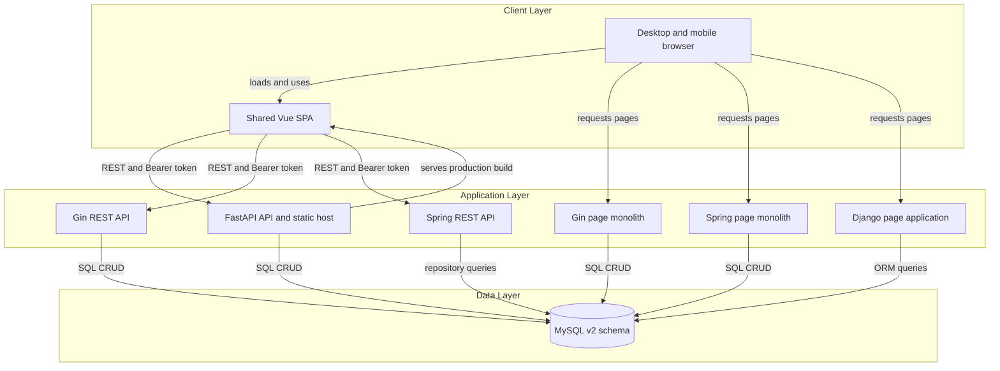
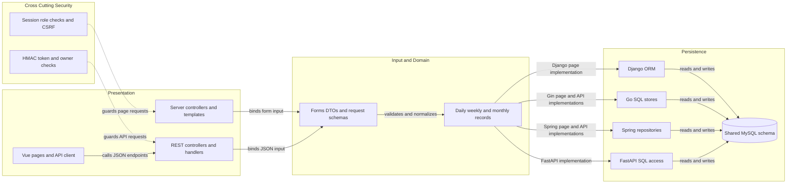

# Architecture Diagram

> **文档版本**：2026.11.20
> **基线日期**：2026-11-20
> **状态**：现状架构（as-built）

本文件描述仓库内个人效能系统的当前实现边界。Go、Spring Boot、Django、FastAPI 是可选择的后端实现；它们不是强制组合在同一个运行进程中的模块。

## Application Architecture

<!-- mermaid-checked: no \n, no em-dash/en-dash, no {} in labels, subgraphs are id["label"], arrows are -->|"label"|, all subgraphs closed by end, ids unique -->

### Technology Stack Summary

| Layer | Technology | Version | Purpose |
|---|---|---|---|
| Shared frontend | Vue, TypeScript, Vite | Vue `^3.5.13`; TypeScript `^5.7.2`; Vite `^6.0.5` | Responsive SPA, API client, Vite development proxy and build |
| Go page backend | Go, Gin, `database/sql` | Go 1.22; Gin 1.10.0 | Server-rendered page application and MySQL persistence |
| Go API backend | Go, Gin, `database/sql` | Go 1.22; Gin 1.10.0 | REST API, HMAC token authentication and MySQL persistence |
| Java page backend | Java, Spring Boot, Thymeleaf, Spring Security, JdbcTemplate | Java 17; Spring Boot 3.2.5 | Server-rendered pages, session security and repository access |
| Java API backend | Java, Spring Boot, Spring Security, JdbcTemplate | Java 17; Spring Boot 3.2.5 | REST API, HMAC token authentication and repository access |
| Django backend | Python, Django, PyMySQL | Django 4.2.16 | Server-rendered pages, session authentication and ORM persistence |
| FastAPI backend | Python, FastAPI, Pydantic, Uvicorn, PyMySQL | FastAPI `>=0.110`; Pydantic v2 models | REST API, request validation, HMAC token authentication and optional static hosting |
| Persistence | MySQL, InnoDB, `utf8mb4` | MySQL 8.0+ | Shared user and daily/weekly/monthly record storage |

### Data Storage & External Services

The application uses a shared MySQL database with eight principal tables: `users`, `daily_plans`, `time_blocks`, `weekly_reviews`, `weekly_domain_reviews`, `weekly_task_flows`, `monthly_reviews`, and `system_health_checks`. Main records belong to users; repeated entries are stored as child records with foreign keys and cascade deletion. No cache, message broker, or third-party API integration was identified in the current implementation.

### Key Architectural Decisions

- The same business data model is implemented independently in Go, Java, Django, and FastAPI; database schema and REST API semantics are the main interoperability contracts.
- The shared Vue source is a standalone project at `versions/vue/pms-vue`; its production build can be served by FastAPI, while development or separate hosting can target any compatible API backend.
- Page-rendered Go, Spring Boot, and Django applications use their own web/session flows. REST APIs use Bearer HMAC tokens; page sessions and API tokens are separate authentication paths.

## Component Relationships

<!-- mermaid-checked: no \n, no em-dash/en-dash, no {} in labels, subgraphs are id["label"], arrows are -->|"label"|, all subgraphs closed by end, ids unique -->

### Component Inventory

| Component | Layer | Type | Responsibility |
|---|---|---|---|
| Vue views | Presentation | SPA pages | Login, dashboard, daily, weekly and monthly interactions |
| Vue API client | Presentation / integration | HTTP client | Sends JSON requests, attaches Bearer token and handles API errors |
| Gin page handlers and templates | Presentation | Server-rendered MVC | Renders authenticated PC / Mobile pages and binds forms |
| Spring page controllers and Thymeleaf | Presentation | Server-rendered MVC | Renders authenticated pages and submits form data |
| Django views, forms and templates | Presentation | Server-rendered MVC | Handles page workflows, authentication and formsets |
| FastAPI routes and schemas | API / validation | REST controllers and request models | Exposes shared API contract and validates request payloads |
| Gin API handlers and models | API / persistence | REST handlers and SQL stores | Implements API contract, user-scoped queries and record persistence |
| Spring API controller and repositories | API / persistence | REST controller and repositories | Implements API contract, HMAC token checks and JdbcTemplate queries |
| Page authentication | Cross-cutting | Session / CSRF | Protects server-rendered page requests using each framework's session flow |
| API authentication | Cross-cutting | HMAC Bearer token | Authenticates API calls and derives current user context |
| MySQL schema | Persistence | Relational database | Stores accounts, main records and child details |

## Data Model and Ownership

| Aggregate | Main record | Child records | Uniqueness |
|---|---|---|---|
| Account | `users` | — | Username is unique |
| Daily execution | `daily_plans` | `time_blocks` | One record per user and date |
| Weekly review | `weekly_reviews` | `weekly_domain_reviews`, `weekly_task_flows` | One record per user and week start |
| Monthly reset | `monthly_reviews` | `system_health_checks` | One record per user and month |

Child records are owned through their parent record. Main records include `user_id`; cross-user access is filtered by ownership. Deleting a main record cascades to its children.

## Authentication and Request Flow

- **Page applications**: username/password login establishes a framework-specific session. Go and Spring page applications retain CSRF protection; Django uses Django authentication/session middleware and CSRF middleware.
- **API applications**: `POST /api/auth/login` issues a 24-hour HMAC-SHA256 Bearer token. Compatible API versions use the same `API_SECRET` and token claims convention. Subsequent requests validate the token and scope data access to the identified user.
- **Vue**: the API client stores its token in browser `sessionStorage`, attaches `Authorization: Bearer ...`, and clears it after a 401 response.
- **User administration**: the API contract supports admin-only user listing and creation. The shared Vue application currently has no user-administration screen.

## Runtime Boundaries and Constraints

- Default ports are 8081 for Gin, 8080 for Spring Boot, and 8000 for Django and FastAPI. A page app and API app of the same language share their default port and cannot bind it simultaneously without configuration changes.
- Gin and Spring API projects support CORS configuration for separately hosted Vue; FastAPI also has configurable CORS. Production origins and signing secrets must be set for the deployment.
- The schema scripts initialize missing tables; they are not a general versioned migration system for changing existing schemas.
- Transaction behavior is not uniform across implementations. In particular, FastAPI opens autocommit connections for individual SQL operations; callers must not assume that parent and child writes are atomic across every backend.
- The architecture is a set of alternative application implementations sharing contracts and storage, not a distributed microservice system. No service-to-service messaging or shared cache is present.
