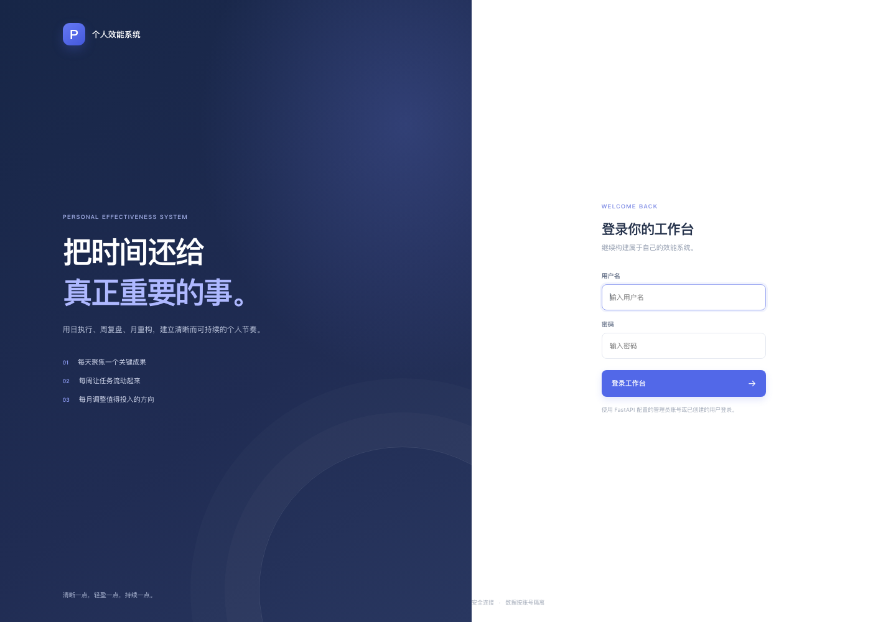
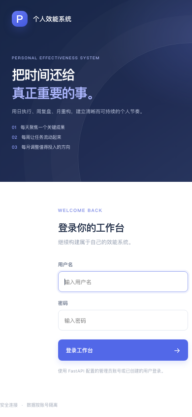

# 个人效能系统 · 四版本实现

> **v4（当前）**：四版本全部基于「个人效能系统」v2 数据模型；Django / Spring Boot / Gin 三版提供 **PC / Mobile 双端界面**（独立模板 + UA 自动识别 + 手动切换），FastAPI 提供 **Vue 3 响应式页面 + REST API**。四版共用数据表与账号数据；Spring Boot / Gin / FastAPI 共用 REST API 契约与 HMAC Token。
>
> 历史版本：v3 = 三版业务迁移到效能模型（`af45fbf`）；v2 = 按 PDF 重设计表结构与 Django 界面（`00850f2`）；v1 = 原 PMS 项目/任务系统基线（`a702875`），旧建表语句见 [db/schema.v1-legacy.sql](db/schema.v1-legacy.sql)。

---

## 一、这是一个什么系统（业务场景）

这是一个把「个人效能方法论」落到可执行、可复盘、可数字化 tracking 的系统。它源自附件《个人效能系统 · 可手写打印 · 版本 1.0》的三张 A4 清单，把它们变成可以在电脑和手机上填写、保存、统计的工具。

核心闭环是 **「日执行 → 周复盘 → 月重构」** 三层节奏：

| 节奏 | 解决的问题 | 系统里的载体 |
|------|-----------|------------|
| **每日执行** | 今天到底要先做出什么成果？如何把注意力切成可交付的组块？ | 今日 MIT、时间盒组块（输入/关键动作/可验收输出）、执行前后 9 项检查、生活维护 4 项、晚间 5 分钟复盘 |
| **每周复盘** | 这一周的事实是什么？任务流有没有堆积？下周少而明确的承诺是什么？ | 4 领域事实与状态、任务流四栏清理（待办/进行中/已完成/删除委托延后）、下周 1–3 项成果、深度时间、If-Then 计划、5 个复盘问题 |
| **每月重构** | 目标还值得投入吗？系统本身健康吗？下月只改哪三件事？ | 目标与价值检查、6 模块系统健康自评（1–5 分）、三项改进（保留/删减/实验）、季度方向校准 |

典型使用场景：

- **晨间启动**：打开手机端「每日执行」，写下今天最重要的一个成果（MIT），把上午/下午切成 2–4 个时间盒，每个盒子写清「输入 / 关键动作 / 可验收输出」。
- **执行中**：一次只做一个组块；卡住时先缩小下一步；结束一个盒子就勾选完成，并检查「有可见产出 / 做了主动回忆 / 标记下一步」。
- **晚间复盘**：花 5 分钟回答四个问题——真正完成了什么、最大阻力、明天最小启动动作、值得感谢的一件事。
- **周末复盘**：用 30–45 分钟按事实回顾工作/学习/身体/关系四领域，清理任务流，定下周最多 3 项成果与要保护的深度时间。
- **月末重构**：用 45–60 分钟检查目标是否仍值得投入、给系统健康打分、只挑三件事改进。

## 页面截图

以下为共享 Vue 前端的登录页实际渲染效果，分别展示桌面和移动端布局。登录后的业务页面需连接后端并使用有效账号访问。

**桌面端（1440 × 1000）**

<p align="center">
  
</p>

**移动端（390 × 844）**

<p align="center">
  
</p>

## 二、目标人群

- **知识工作者 / 研发 / 产品 / 设计**：任务多、干扰多，需要把「忙碌」转化为「可见成果」的人。
- **自由职业者 / 远程工作者**：没有外部节奏约束，需要自建日周月节奏与注意力保护区。
- **学生 / 备考者 / 研究者**：需要时间盒与主动回忆、阶段性复盘的深度学习者。
- **管理者 / 团队负责人**：既要管团队项目，也要管自己的注意力与节奏；系统按用户隔离，可一人一套。
- **方法论实践者**：已经在用 GTD、时间块、PDCA、OKR，希望有一个轻量工具把清单数字化、可检索、可统计的人。

## 三、痛点与解法

| 痛点 | 传统做法的困境 | 本系统的解法 |
|------|--------------|------------|
| **忙了一天却说不出成果** | 待办清单只记录"做了什么"，不区分重要成果与杂事 | 每天强制先写 **MIT**，组块必须写「可验收输出」，晚上复盘"真正完成了什么" |
| **任务越堆越多、永远清不完** | Todo 列表只增不减，没有退出机制 | 每周复盘设「删除/委托/延后」栏，任务流有明确的 outflow |
| **计划排得太满、总是失败** | 排满时间表，一被打断就全盘崩溃 | 时间盒"结束检查进度，不要求强行做完"；下周成果限 1–3 项；深度时间只保护少量 |
| **没有复盘，重复踩坑** | 只有计划没有回顾，偏差无法修正 | 日/周/月三层复盘，问题固定化（阻力、估算偏差、继续/调整/停止） |
| **系统本身变成负担** | 工具越来越复杂，维护工具本身耗时 | 三张清单字段固定、填写快；系统健康自评专门检查"系统是否成为负担" |
| **只顾产出、忽略生活基本盘** | 效率工具常把人当机器 | 每日「生活维护」4 项（饮水饮食/运动/清洁/真实交流），不追求满分只保持基本盘 |
| **纸质清单无法统计与检索** | 手写卡片不可搜索、不可回溯趋势 | 数字化存储，进度读时计算，可按日期/周/月回溯，系统健康分数可比对 |
| **电脑和手机切换割裂** | 一套界面在手机上缩放难用 | 三版提供 PC / Mobile 独立模板：手机端卡片流 + 底部 Tab + 大按钮，切回电脑数据一致 |

## 四、版本与技术栈

`versions/` 按服务端语言或前端技术归档。共享 Vue 应用独立放在 `versions/vue/pms-vue/`；FastAPI 仍可将 Vue 构建产物与 API 同源提供。

| 平台 / 语言 | 实现 | 技术栈 | 默认端口 | 界面 | REST API | 认证方式 |
|------------|------|--------|---------|------|----------|---------|
| Go | Gin 单体页面版 | Gin + database/sql + html/template | 8081 | ✅ PC / Mobile 双端 | — | 签名 Cookie + CSRF |
| Go | Gin REST API | Gin + database/sql | 8081 | 共享 Vue | ✅ `/api/**` | HMAC Token |
| Java | Spring Boot 单体页面版 | Spring Boot 3.2 + Thymeleaf + Security + JdbcTemplate | 8080 | ✅ PC / Mobile 双端 | — | Spring Session + CSRF |
| Java | Spring Boot REST API | Spring Boot 3.2 + JdbcTemplate | 8080 | 共享 Vue | ✅ `/api/**` | HMAC Token |
| Python | Django | Django 4.2 + MySQL | 8000 | ✅ PC / Mobile 双端 | — | Django Session |
| Python | FastAPI | FastAPI + Vue 3 + TypeScript + PyMySQL | 8000 | ✅ 响应式 PC / Mobile 页面 | ✅ 全部 | HMAC Token |
| Vue | PMS Vue | Vue 3 + TypeScript + Vite | 5173 | ✅ 响应式 PC / Mobile 页面 | 调用共享 API | Bearer Token |

> Django 与 FastAPI 默认都是 8000，同时启动需用 `SERVER_PORT` 错开。Go / Java 的单体页面版与 API 版也使用相同默认端口，不能同时启动。

**共享数据层**

- 建表脚本 [db/schema.sql](db/schema.sql)（5 处副本一致）；效能表：每日 `daily_plans` + `time_blocks`，每周 `weekly_reviews` + `weekly_domain_reviews` + `weekly_task_flows`，每月 `monthly_reviews` + `system_health_checks`。
- 字段映射与设计说明见[数据模型设计](docs/data/schema-design.md)；REST API 契约见[API 契约](docs/data/api-contract.md)。
- 密码统一 BCrypt。默认管理员首次启动且 users 为空时自动创建，生产环境务必用 `ADMIN_USERNAME` / `ADMIN_PASSWORD` 覆盖。

**文档导航**

所有文档及按项目整理的搭建、部署指南见[文档中心](docs/README.md)。

| 文档 | 介绍 |
|------|------|
| [使用指南](docs/guides/user-guide.zh-CN.md)（[English](docs/guides/user-guide.en.md) · [繁體中文](docs/guides/user-guide.zh-TW.md) · [日本語](docs/guides/user-guide.ja.md)） | 面向使用者，说明登录与设备切换，以及每日执行、每周复盘、每月重构的填写方法和建议节奏。 |
| [PC / Mobile 双端实现规范](docs/guides/dual-view-guidelines.md) | 说明三种服务端页面版的视图切换、模板组织、移动端设计要求和验收标准。 |
| [业务说明与代码应用顺序](docs/business/business-flow-and-code-reading.md) | 从日 / 周 / 月业务闭环出发，介绍 Go、Java、Python 与 Vue 项目的代码阅读路径，并追踪周复盘数据的处理过程。 |
| [中文音视频口播稿](docs/business/business-flow-video-script.zh-CN.md) | 配套业务追踪文档的中文讲解脚本，包含画面提示和时间码，预计时长约 20 分钟。 |
| [需求规格说明书（2026.11.20）](docs/requirements/requirements-2026-11-20.md) | 汇总系统范围、用户场景、功能需求、关键实体与可验证的成功标准。 |
| [架构设计与组件关系（2026.11.20）](docs/architecture/architecture-diagram.md) | 通过架构图和组件关系图概览系统分层、技术栈、数据存储及主要组件职责。 |

## 五、快速开始

公共前提：MySQL（各版首次启动会幂等执行 `schema.sql` 建表）

```bash
mysql -u root -e "CREATE DATABASE IF NOT EXISTS pms CHARACTER SET utf8mb4 COLLATE utf8mb4_unicode_ci;"
```

```bash
# Django
cd versions/python/pms-django && python3 -m venv .venv && source .venv/bin/activate
pip install -r requirements.txt && python manage.py migrate && python manage.py createsuperuser && python manage.py runserver 8000

# Spring Boot 单体页面版（默认 8080）
cd versions/java/pms-springboot && (test -f .env || cp .env.example .env) && ./start.sh

# Gin 单体页面版（默认 8081）
cd versions/go/pms-gin && export GOPROXY=https://goproxy.cn,direct && go mod tidy && go run .

# Spring Boot REST API（默认 8080；与页面版不能同时占用同一端口）
cd versions/java/pms-springboot-api && (test -f .env || cp .env.example .env) && ./start.sh

# Gin REST API（默认 8081；与页面版不能同时占用同一端口）
cd versions/go/pms-gin-api && go run .

# FastAPI + Vue（默认 8000，构建后访问 /，API 文档 /docs）
cd versions/python/pms-fastapi && python3 -m venv .venv && source .venv/bin/activate
pip install -r requirements.txt && (test -f .env || cp .env.example .env)
npm --prefix ../../vue/pms-vue install && npm --prefix ../../vue/pms-vue run build
uvicorn app.main:app --reload --port 8000
```

> 迁移说明：请在新库上使用 v2/v3 表结构；若数据库已有 v1 的 Django 表（`auth_user` / `projects_project` 等），需自行编写数据迁移或另建库。

## 六、目录结构

```
pms/
├── versions/
│   ├── go/
│   │   ├── pms-gin/          Gin 单体版（PC/Mobile 双端页面）
│   │   └── pms-gin-api/      Gin REST API（供共享 Vue 使用）
│   ├── java/
│   │   ├── pms-springboot/   Spring Boot 3.2 单体版（PC/Mobile 双端页面）
│   │   └── pms-springboot-api/ Spring Boot 3.2 REST API（供共享 Vue 使用）
│   ├── python/
│   │   ├── pms-django/       Django 4.2（PC/Mobile 双端页面）
│   │   └── pms-fastapi/      FastAPI REST API（可同源提供 Vue 构建页面）
│   └── vue/
│       └── pms-vue/          共享 Vue 3 + TypeScript 前端
├── db/                   共享建表脚本：schema.sql、schema.v1-legacy.sql
├── docs/                 集中存放业务、指南、架构、数据与项目搭建文档
└── README.md             本文件
```

## 七、部署文档与项目搭建指南

下表为各独立应用提供搭建、构建过程讲解和部署入口；所有文档集中在 `docs/projects/`，详情也可从[文档中心](docs/README.md)按项目浏览。

| 项目 | 搭建指南 | 构建过程讲解 | 部署指南 |
|------|----------|--------------|----------|
| Go Gin 单体页面版 | [搭建](docs/projects/go/pms-gin/setup.md) | [构建讲解](docs/projects/go/pms-gin/build-process-explained.md) | [部署](docs/projects/go/pms-gin/deployment.md) |
| Go Gin REST API | [搭建](docs/projects/go/pms-gin-api/setup.md) | [构建讲解](docs/projects/go/pms-gin-api/build-process-explained.md) | [部署](docs/projects/go/pms-gin-api/deployment.md) |
| Java Spring Boot 单体页面版 | [搭建](docs/projects/java/pms-springboot/setup.md) | [构建讲解](docs/projects/java/pms-springboot/build-process-explained.md) | [部署](docs/projects/java/pms-springboot/deployment.md) |
| Java Spring Boot REST API | [搭建](docs/projects/java/pms-springboot-api/setup.md) | [构建讲解](docs/projects/java/pms-springboot-api/build-process-explained.md) | [部署](docs/projects/java/pms-springboot-api/deployment.md) |
| Python Django 页面版 | [搭建](docs/projects/python/pms-django/setup.md) | [构建讲解](docs/projects/python/pms-django/build-process-explained.md) | [部署](docs/projects/python/pms-django/deployment.md) · [不停机发布](docs/projects/python/pms-django/hot-deployment.md) |
| Python FastAPI + Vue 同源版 | [搭建](docs/projects/python/pms-fastapi/setup.md) | [构建讲解](docs/projects/python/pms-fastapi/build-process-explained.md) | [部署](docs/projects/python/pms-fastapi/deployment.md) |
| Vue 共享前端 | [搭建](docs/projects/vue/pms-vue/setup.md) | [构建讲解](docs/projects/vue/pms-vue/build-process-explained.md) | [部署](docs/projects/vue/pms-vue/deployment.md) |

> 生产环境务必修改各版本 `.env` 中的数据库账号、管理员密码与密钥；三版 `API_SECRET` 需一致才能跨版本互认 Token。

## 八、API 互通验证

```bash
# 此处启动的是 Spring Boot API（pms-springboot-api），不是同端口的单体页面版
TOKEN=$(curl -s -X POST http://127.0.0.1:8080/api/auth/login \
  -H 'Content-Type: application/json' \
  -d '{"username":"admin","password":"admin123"}' | python3 -c 'import sys,json;print(json.load(sys.stdin)["token"])')

curl -s http://127.0.0.1:8081/api/me -H "Authorization: Bearer $TOKEN"
curl -s http://127.0.0.1:8000/api/me -H "Authorization: Bearer $TOKEN"
```

## 九、构建与实测状态

| 检查项 | 结果 |
|--------|------|
| Django `manage.py check` / 模板编译 / 迁移检查 | ✅ 无问题 |
| Spring Boot `mvn test` | ✅ 通过 |
| Gin `go build ./...` + `go vet ./...` | ✅ 通过 |
| FastAPI `compileall` + 路由注册 | ✅ 通过 |
| 三版 Token 交叉验证（3×3 = 9 组合） | ✅ 全部 200 |
| 跨版本 CRUD（FastAPI 建 → 三版读、跨版更新三版可见） | ✅ 通过 |
| 真实 MySQL 上端到端 CRUD（日/周/月 + 明细替换 + 用户隔离） | ✅ 通过 |
