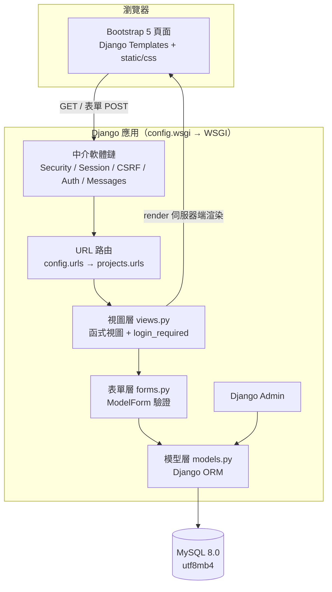
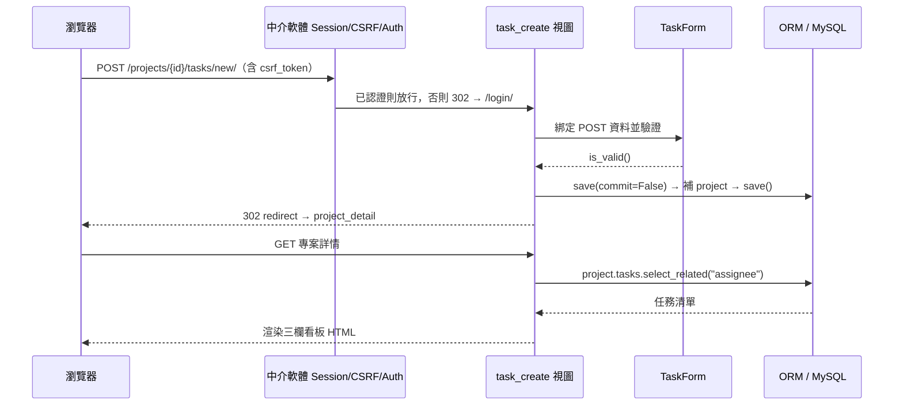
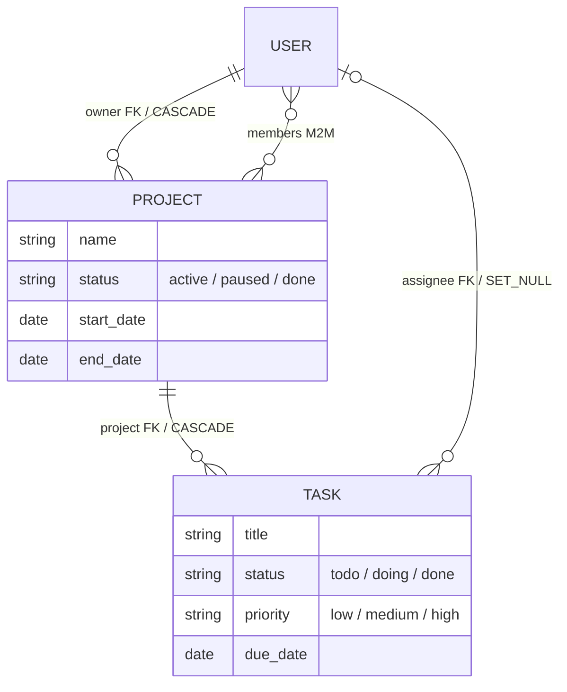
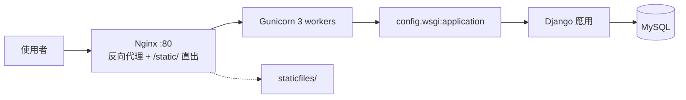

# PMS 專案管理系統

[简体中文](README.md)（預設入口） · [简体中文 zh-CN](README.zh-CN.md) · [繁體中文](README.zh-TW.md) · [English](README.en.md)

以 **Django 4.2 + MySQL** 打造的輕量級專案與任務管理系統。提供帳號認證、工作臺統計概覽、專案管理、成員管理、任務看板（待處理 / 進行中 / 已完成）以及 Django Admin 後台。介面為中文，使用 Bootstrap 5，預設時區 `Asia/Shanghai`。

> 正式環境部署（Gunicorn + Nginx + systemd）與常見問題排查，請見 [部署文档.md](部署文档.md)（簡體中文）。架構設計見[第 3 節](#3-架構設計)。

---

## 1. 功能特色

- **帳號**：Django 內建認證，登入 / 登出；所有業務頁面皆需登入（`login_required`）。
- **工作臺**：專案總數、任務總數、各狀態任務數；「我的專案」（前 5 筆）與「我的待辦」（前 10 筆未完成任務）。
- **專案管理**：新增、編輯、刪除、詳情；依狀態與名稱篩選；負責人與成員管理；依已完成任務比例計算的進度條。**編輯與刪除僅負責人可操作**。
- **任務管理**：專案詳情內的三欄看板，可指派執行人、設定優先順序（低 / 中 / 高）與截止日期，並切換狀態。
- **後台管理**：於 Django Admin 管理 `Project` / `Task`，支援篩選、搜尋與成員橫向選擇。

## 2. 技術棧與環境需求

| 層級 | 選用 |
|------|------|
| 後端 | Python 3.10+、Django 4.2.16 |
| 資料庫 | MySQL 8.0+（5.7 亦可），`utf8mb4` |
| 驅動 | PyMySQL 1.1.1 + `cryptography`；於 `config/__init__.py` 中偽裝為 `MySQLdb`，無須編譯 mysqlclient |
| 前端 | Django Templates + Bootstrap 5.3.3（CDN）+ 自訂 `static/css/style.css` |
| 部署 | Gunicorn 22.0.0，Nginx 反向代理（正式環境選用） |

依賴固定版本見 `requirements.txt`：`Django==4.2.16`、`PyMySQL==1.1.1`、`cryptography>=42.0.0`、`gunicorn==22.0.0`。

自訂樣式位於 `static/css/style.css`：以 CSS 變數統一配色、圓角與卡片陰影，覆蓋導覽列、工作臺統計卡、表格與進度條、任務看板三欄、表單及登入頁，並包含行動端調適與「減少動態效果」偏好支援。它在 Bootstrap CDN 之後載入，僅做視覺增強，不改動網格與元件結構。

## 3. 架構設計

### 3.1 分層架構



系統採用**經典 Django MTV 單體架構**：沒有獨立前端工程、沒有 REST API 層，也沒有訊息佇列與快取；頁面全部由伺服器端渲染，瀏覽器只負責展示與提交表單。

| 層級 | 職責 | 程式位置 |
|----|------|---------|
| 路由 | URL 分發；根路由掛載 `projects.urls` 與 Admin | `config/urls.py`、`projects/urls.py` |
| 視圖 | 權限關卡、查詢組裝、表單處理、重新導向 | `projects/views.py` |
| 表單 | 欄位白名單、驗證與控制項樣式 | `projects/forms.py` |
| 模型 | 業務實體、狀態枚舉、衍生統計（進度） | `projects/models.py` |
| 模板 | 頁面結構與 Bootstrap 展示 | `templates/`、`static/css/style.css` |
| 設定 | 環境變數、資料庫、認證跳轉、靜態檔案 | `config/settings.py` |
| 後台 | 資料維護與檢索 | `projects/admin.py` |

### 3.2 請求生命週期（以新增任務為例）



所有寫入操作遵循 **POST → 驗證 → 落庫 → 重新導向（PRG）** 模式，避免重新整理造成重複提交；頁面不使用 AJAX，任務狀態透過獨立編輯表單變更。

### 3.3 資料模型關係



- **進度為讀時計算**：`Project.progress` 由 `tasks.filter(status="done").count() / task_count` 即時得出，不落庫，無須額外同步。
- 看板依 `status` 分組渲染；任務預設排序為 `status, -priority, due_date`。
- 級聯策略：刪除專案 → 級聯刪除其任務；刪除負責人 → 級聯刪除其名下專案（及其任務）；刪除執行人 → 任務保留，`assignee` 設為空值。

### 3.4 認證與權限邊界

| 邊界 | 實作方式 |
|------|---------|
| 未登入存取 | `@login_required` 統一跳轉 `LOGIN_URL = "login"` |
| 登入 / 登出後 | `LOGIN_REDIRECT_URL = "dashboard"`；登出回到登入頁 |
| 專案寫入操作 | `project.owner != request.user` 時靜默重新導向回詳情頁 |
| 任務寫入操作 | **尚無物件層級權限驗證**，見[第 10 節](#10-注意事項與已知限制) |
| 後台 | Django Admin 內建 `is_staff` 與模型層級權限 |

### 3.5 設定與啟動鏈路

1. `manage.py` / `config.wsgi` 設定 `DJANGO_SETTINGS_MODULE = config.settings`。
2. 匯入 `config` 套件時先執行 `config/__init__.py`：將 PyMySQL 註冊為 `MySQLdb`，並偽裝版本號繞過 Django 的驅動版本檢查，因此無須編譯 `mysqlclient`。
3. `settings.py` 以內建極簡載入器讀取 `.env`（`os.environ.setdefault`，系統環境變數優先），據此組裝 `DATABASES`（`utf8mb4` + `STRICT_TRANS_TABLES`）。
4. `ROOT_URLCONF = config.urls` → `projects.urls`；模板自 `templates/` 載入，靜態資源來自 `static/`，正式環境由 `collectstatic` 彙總至 `staticfiles/`。

### 3.6 部署拓撲



### 3.7 設計取捨與擴充點

| 目前取捨 | 影響 | 可選演進 |
|---------|------|---------|
| 伺服器端渲染、無 API 層 | 實作簡單，但難以支援行動端與第三方整合 | 導入 Django REST Framework，拆出序列化器 |
| 視圖內嵌統計查詢 | 無需快取，小資料量足夠 | 大表場景改用 `annotate` / 快取 / 分頁 |
| 進度即時計算 | 資料始終一致 | 任務量大時改為冗餘計數欄位 + 信號維護 |
| 任務無物件層級權限 | 任何登入使用者可修改任意任務 | 增加權限驗證層或自訂策略 |
| 看板無拖曳 | 狀態變更需進入編輯頁 | 導入 SortableJS + 狀態更新介面 + CSRF |
| 無自動化測試 | 回歸依賴人工 | 為視圖、模型、權限補齊 `tests.py` 案例 |

## 4. 快速開始

前置條件：已安裝並啟動 MySQL，且擁有可建立資料庫的帳號。

**① 建立資料庫**（於 MySQL 客戶端執行）

```sql
CREATE DATABASE pms DEFAULT CHARACTER SET utf8mb4 COLLATE utf8mb4_unicode_ci;
```

如需專用帳號，可參考 [部署文档.md](部署文档.md) 第三節的建立使用者與授權 SQL。

**② 建立虛擬環境並安裝依賴**

```bash
python3 -m venv .venv
source .venv/bin/activate        # Windows: .venv\Scripts\activate
pip install -r requirements.txt
```

**③ 設定環境變數**

```bash
cp .env.example .env
# 依需求修改 DB_*、SECRET_KEY、DEBUG
```

> `.env.example` 中的 `SECRET_KEY` 僅為開發用佔位值，正式環境必須更換；`.env` 已由 `.gitignore` 排除，請勿提交。

**④ 初始化資料庫並建立管理員**

```bash
python manage.py migrate
python manage.py createsuperuser
```

儲存庫已包含 `projects/migrations/0001_initial.py`。若修改了模型，再執行 `python manage.py makemigrations projects` 後重新 `migrate`。

**⑤ 啟動開發伺服器**

```bash
python manage.py runserver 0.0.0.0:8000
```

以瀏覽器開啟 <http://127.0.0.1:8000/> 登入使用；後台網址為 <http://127.0.0.1:8000/admin/>。

## 5. 環境變數

`config/settings.py` 內建極簡 `.env` 載入器（每行 `KEY=VALUE`，`#` 開頭為註解），使用 `os.environ.setdefault`，因此**系統環境變數優先於 `.env` 檔案**。

| 變數 | 預設值 | 說明 |
|------|--------|------|
| `DEBUG` | `True` | 值為 `1` / `true` / `yes` 時視為開啟（不分大小寫） |
| `SECRET_KEY` | `dev-insecure-secret-key-change-me` | Django 簽章密鑰，正式環境必須更換 |
| `DB_NAME` | `pms` | 資料庫名稱 |
| `DB_USER` | `root` | 資料庫帳號 |
| `DB_PASSWORD` | 空 | 資料庫密碼 |
| `DB_HOST` | `127.0.0.1` | 資料庫位址 |
| `DB_PORT` | `3306` | 資料庫埠號 |

其他固定設定：`LANGUAGE_CODE = "zh-hans"`、`TIME_ZONE = "Asia/Shanghai"`、`USE_TZ = True`、`STATIC_ROOT = staticfiles/`。

## 6. 目錄結構

```
pms/
├── manage.py                     # Django 管理入口
├── requirements.txt              # Python 依賴
├── .env.example                  # 環境變數範例（複製為 .env 使用）
├── 部署文档.md                    # 簡體中文詳細部署與除錯文件
├── 热部署文档.md                  # 不停機發布（HUP 優雅重載）文件
├── README.md / README.zh-CN.md / README.zh-TW.md / README.en.md
├── deploy/                       # 正式環境與熱部署設定
│   ├── gunicorn.conf.py          # Gunicorn 優雅重載參數
│   ├── pms.service               # systemd 單元（ExecReload）
│   ├── hot-deploy.sh             # 正式環境一鍵熱部署指令稿
│   └── local-hot.sh              # 本機命令列熱部署 / watch
├── config/
│   ├── __init__.py               # PyMySQL → MySQLdb 相容層
│   ├── settings.py               # 全域設定（讀取 .env）
│   ├── urls.py                   # 根路由
│   └── wsgi.py                   # WSGI 入口
├── projects/                     # 核心應用
│   ├── models.py                 # Project / Task 模型
│   ├── views.py                  # 登入、工作臺、專案、任務視圖
│   ├── forms.py / admin.py / urls.py / apps.py
│   ├── migrations/0001_initial.py
│   └── tests.py
├── templates/                    # base / dashboard / registration / projects 頁面模板
└── static/css/style.css
```

## 7. 頁面與路由

| 路徑 | 說明 |
|------|------|
| `/` | 工作臺（統計概覽） |
| `/login/`、`/logout/` | 登入、登出 |
| `/projects/` | 專案列表，支援 `?status=` 與 `?q=` 篩選 |
| `/projects/new/` | 新增專案（建立者自動成為負責人） |
| `/projects/<pk>/` | 專案詳情與任務看板 |
| `/projects/<pk>/edit/`、`/delete/` | 編輯、刪除專案（僅負責人） |
| `/projects/<project_pk>/tasks/new/` | 新增任務 |
| `/tasks/<pk>/edit/`、`/delete/` | 編輯、刪除任務 |
| `/admin/` | Django Admin 後台 |

## 8. 資料模型

**Project（專案）**：`name`、`description`、`status`（`active` 進行中 / `paused` 已暫停 / `done` 已完成）、`start_date`、`end_date`、`owner`（外鍵 → User）、`members`（多對多 → User）、`created_at`、`updated_at`。依建立時間倒序排列；衍生屬性 `task_count`、`done_task_count`、`progress`（完成任務百分比）。

**Task（任務）**：`project`（外鍵 → Project）、`title`、`description`、`assignee`（外鍵 → User，可空）、`status`（`todo` / `doing` / `done`）、`priority`（`low` / `medium` / `high`）、`due_date`、`created_at`、`updated_at`。預設依 `status`、`-priority`、`due_date` 排序。

刪除專案會級聯刪除其下所有任務；刪除執行人使用者時，任務的 `assignee` 會設為空值。

## 9. 正式環境部署要點

- 設定 `DEBUG=False`，更換 `SECRET_KEY`；`ALLOWED_HOSTS` 目前於 `settings.py` 中寫死為 `["*"]`，上線前請改為實際網域。
- 收集靜態檔案：`python manage.py collectstatic --noinput`（輸出至 `staticfiles/`）。
- 啟動應用：`gunicorn config.wsgi:application --bind 127.0.0.1:8000 --workers 3`。
- 由 Nginx 反向代理應用，並直接託管 `/static/`。

完整的 systemd 服務設定、Nginx 設定範例與除錯對照表，請見 [部署文档.md](部署文档.md) 第五、六節。

**熱部署（不停機發布）**：`deploy/pms.service` 以 `ExecReload=/bin/kill -HUP $MAINPID` 觸發 Gunicorn 優雅重載；日常發布執行 `./deploy/hot-deploy.sh`（可先加 `--dry-run` 演練），指令稿依序完成程式碼拉取、依賴安裝、`migrate`、`collectstatic`、HUP 重載與 `/login/` 健康檢查，全程不中斷，Nginx 無須 reload。前提是 `preload_app = False` 且資料庫遷移向後相容；詳見 [热部署文档.md](热部署文档.md)。

本機開發可直接用 `./deploy/local-hot.sh`：預設執行 HUP 熱重載，`watch` 子命令監聽 `.py` / `.html` / `.css` 變化自動重載，另有 `start` / `status` / `stop`；無須 systemd、sudo 或額外監聽工具，詳見該文件第十節。

## 10. 注意事項與已知限制

- 任務的**新增 / 編輯 / 刪除目前僅要求登入**，未依專案負責人或執行人做權限驗證；專案的編輯與刪除則已限制為負責人。
- Bootstrap 5 的 CSS / JS 來自 jsDelivr CDN，離線或內網部署時需改為本機靜態資源。
- 專案列表尚未分頁；工作臺「我的專案」「我的待辦」分別只顯示前 5 / 前 10 筆。
- `projects/tests.py` 目前僅有匯入陳述式，尚未撰寫測試案例。
- 儲存庫未宣告開源授權，如需對外發布請先補上 `LICENSE`。

## 11. 檢查與測試

```bash
python manage.py check
python manage.py test
```

## 12. 相關文件

| 文件 | 內容 |
|------|------|
| [部署文档.md](部署文档.md) | 環境準備、建庫 SQL、正式環境部署、常見問題、後續擴充建議（簡體中文） |
| [热部署文档.md](热部署文档.md) | Gunicorn HUP 優雅重載、一鍵發布指令稿、回滾與除錯（簡體中文） |
| [README.md](README.md) | 簡體中文（預設入口） |
| [README.zh-CN.md](README.zh-CN.md) | 簡體中文（依語言代碼命名的副本） |
| [README.zh-TW.md](README.zh-TW.md) | 繁體中文版 |
| [README.en.md](README.en.md) | English version |

## 13. 授權

尚未宣告開源授權。
