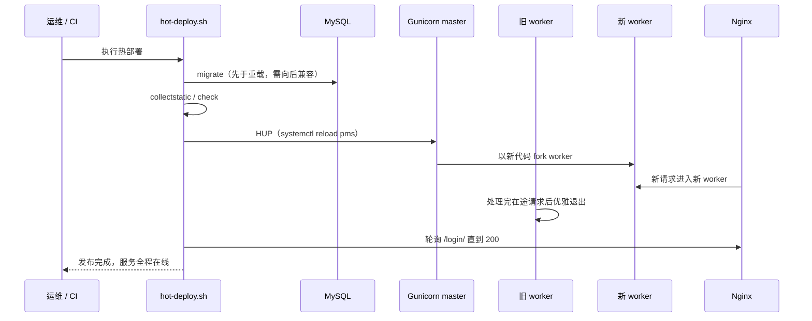

# PMS 热部署（不停机发布）文档

基于 **Gunicorn HUP 优雅重载** 的热部署方案：发布新代码时服务不中断，Nginx 无需 reload，用户请求由旧 worker 处理完后再切到新 worker。

> 前置阅读：[部署文档.md](部署文档.md)（环境准备、建库、Nginx 配置、常见问题）。本文是其第五节的延伸。
> 简体中文文档；多语言项目说明见 [README.md](README.md)。

---

## 一、方案边界与原理

「热部署」在本项目中指：**代码 / 模板 / 静态资源更新后，不停止服务、不返回 502，平滑切换到新版本**。它不涵盖 Gunicorn 自身二进制升级（见第八节进阶）和 Kubernetes 式滚动编排。



关键机制：

| 机制 | 配置位置 | 作用 |
|------|---------|------|
| `ExecReload=/bin/kill -HUP $MAINPID` | `deploy/pms.service` | `systemctl reload pms` 触发优雅重载 |
| `preload_app = False` | `deploy/gunicorn.conf.py` | **必须**，否则 master 预加载旧代码，HUP 后仍是旧版本 |
| `graceful_timeout = 60` | 同上 | 旧 worker 处理完在途请求的最长等待时间 |
| `max_requests` + jitter | 同上 | 平时错峰回收 worker，保证任何时刻都有实例可用 |
| `Restart=always` | `pms.service` | 异常退出自动拉起 |
| Nginx 上游固定 `127.0.0.1:8000` | 部署文档第五节 | 重载期间监听端口不变，Nginx 无需改动 |

## 二、文件清单

| 文件 | 用途 |
|------|------|
| `deploy/gunicorn.conf.py` | Gunicorn 生产配置：绑定、worker 数、优雅超时、pidfile、日志 |
| `deploy/pms.service` | systemd 单元，含 `ExecReload`、`RuntimeDirectory`、`Restart` |
| `deploy/hot-deploy.sh` | 一键热部署脚本（拉代码 → 依赖 → check → migrate → collectstatic → HUP → 健康检查） |
| `部署文档.md` | 基础部署、Nginx 配置、排错（既有文档） |
| `热部署文档.md` | 本文 |

## 三、首次接入

假设应用部署在 `/opt/pms`，虚拟环境为 `/opt/pms/.venv`，运行用户 `www-data`（与 `pms.service` 中的路径保持一致；不同路径请同步修改两处配置）。

```bash
# 1. 安装服务单元（路径按实际情况调整）
sudo cp deploy/pms.service /etc/systemd/system/pms.service
sudo mkdir -p /opt/pms/run && sudo chown www-data:www-data /opt/pms/run
sudo systemctl daemon-reload
sudo systemctl enable --now pms

# 2. 确认服务已就绪
systemctl status pms
curl -s -o /dev/null -w '%{http_code}\n' http://127.0.0.1:8000/login/   # 期望 200
```

说明：

- `EnvironmentFile=-/opt/pms/.env` 让 systemd 注入数据库等变量；项目 `settings.py` 自身也会读取 `.env`（`os.environ.setdefault`，故 systemd 注入值优先）。`.env` 中若密码含空格或 `#`，请加引号或改用 systemd 环境变量。
- `RuntimeDirectory=pms` 由 systemd 创建 `/run/pms` 并赋权，`GUNICORN_PIDFILE=/run/pms/gunicorn.pid` 与之对应。
- 健康检查选用 `/login/` 而非 `/`：前者匿名可访问并返回 200，后者未登录会 302，不适合作为探活端点。
- 脚本通过 `sudo systemctl reload` 触发重载。若以普通用户运行，请为该用户配置免密 sudo（仅 `systemctl reload pms`），或直接用 root 执行。

## 四、日常发布

```bash
cd /opt/pms
./deploy/hot-deploy.sh
```

发布前先演练（不执行任何操作）：

```bash
./deploy/hot-deploy.sh --dry-run
```

常用形式：

```bash
# 代码已由 CI / rsync 同步到位，只做后续步骤
./deploy/hot-deploy.sh --skip-git

# 纯模板或 CSS 改动，跳过数据库迁移
./deploy/hot-deploy.sh --skip-migrate

# 自定义路径与服务名
PMS_APP_DIR=/srv/pms PMS_SERVICE=pms-web ./deploy/hot-deploy.sh
```

| 参数 / 变量 | 默认值 | 说明 |
|-------------|--------|------|
| `--dry-run` | 关闭 | 只打印命令，不改动任何文件 |
| `--skip-git` | 关闭 | 跳过 `git pull --ff-only` |
| `--skip-migrate` | 关闭 | 跳过 `migrate` |
| `--app-dir` / `PMS_APP_DIR` | `/opt/pms` | 应用根目录 |
| `--service` / `PMS_SERVICE` | `pms` | systemd 服务名 |
| `PMS_HEALTH_URL` | `http://127.0.0.1:8000/login/` | 探活地址 |
| `PMS_HEALTH_RETRIES` / `PMS_HEALTH_INTERVAL` | `10` / `2` | 探活次数与间隔（秒） |
| `GUNICORN_PIDFILE` | `$APP_DIR/run/gunicorn.pid` | 无 systemd 时用于 `kill -HUP` |

> **当前仓库尚未初始化 git**（本地工作目录无 `.git`）。脚本检测到没有 `.git` 会自动跳过拉取并继续后续步骤，因此可直接用 `--skip-git`；接入 CI 前请先 `git init` 并推送到远端。

脚本任一步骤失败都会因 `set -e` 立即中止，**不会触发 HUP**，服务保持旧版本继续运行。

## 五、回滚

```bash
cd /opt/pms
git reset --hard <上一版本 commit>     # 或用发布前记录的 PREV_VERSION
./deploy/hot-deploy.sh --skip-git      # 重新走一遍优雅重载
```

⚠️ **数据库迁移通常不可逆**：若本次发布包含 `migrate`，回滚代码前必须确认新迁移与旧代码兼容（例如只新增了可空字段、未删除旧代码仍在用的列/表），否则需单独编写反向迁移。健康检查失败时脚本会打印上一版本号和回滚提示。

## 六、注意事项（务必阅读）

1. **迁移必须向后兼容**：HUP 后旧 worker 会短暂与新 worker 共存（最长 `graceful_timeout = 60s`）。禁止在发布中直接删除/改名字段或表；采用「先加新字段 → 发新版 → 再清理旧字段」的两阶段发布。
2. **迁移先于重载**：脚本顺序固定为 `migrate` → `collectstatic` → `HUP`，不要颠倒。
3. **`preload_app` 保持 False**：设为 True 可节省内存，但 HUP 不会重新加载代码，热部署会静默失效。
4. **静态文件**：`collectstatic` 会覆盖 `staticfiles/`。若前端有 CDN 或浏览器强缓存，需配合文件哈希/版本号刷新，否则用户可能仍看到旧 CSS。
5. **长连接不适用**：本方案面向短 HTTP 请求。若有 WebSocket、SSE 或超过 60s 的长请求，需调大 `graceful_timeout` 或改用蓝绿部署。
6. **多机部署**：逐台执行脚本（一台健康检查通过后再下一台），避免全量同时重载。
7. **发布前检查**：`check --deploy` 的输出脚本只提示不阻断，请人工确认 `DEBUG=False`、`SECRET_KEY`、`ALLOWED_HOSTS`（当前硬编码 `["*"]`）等项。
8. **不要在业务高峰执行 DDL**：`migrate` 可能锁表，与热部署机制无关但会影响可用性。

## 七、常见问题

| 现象 | 排查与处理 |
|------|-----------|
| HUP 后页面还是旧代码 | 检查 `gunicorn.conf.py` 的 `preload_app` 是否为 False；确认 `systemctl reload` 真的执行（`journalctl -u pms -n 50`）；清掉 `run/` 下的陈旧 pidfile |
| `systemctl reload` 报单元不存在 | `sudo systemctl daemon-reload`，确认服务文件已复制到 `/etc/systemd/system/` |
| 找不到 pidfile | 确认 `GUNICORN_PIDFILE` 与 `RuntimeDirectory` 一致；独立运行时先 `mkdir -p $APP_DIR/run` |
| 重载期间偶发 502 | 调大 `graceful_timeout`；检查是否有请求超过 `timeout = 60`；确认 worker 数 ≥ 2 |
| 健康检查一直失败 | 直接 `curl -i http://127.0.0.1:8000/login/`；看 `journalctl -u pms -n 100`；确认 `.env` 数据库配置与迁移是否成功 |
| `migrate` 报锁表 / 连接错误 | 避开高峰；检查 MySQL 账号权限与 `DB_HOST`；参考部署文档第六节 |
| 脚本执行 `git pull` 失败 | 本地非 git 仓库或存在未提交改动，改用 `--skip-git` 或先清理工作区 |

## 八、进阶

- **蓝绿部署**：启动第二套 Gunicorn（如 `127.0.0.1:8001`），健康检查通过后切换 Nginx `upstream` 并 `nginx -s reload`，可做到连旧 worker 共存窗口都没有；适合含破坏性迁移的版本。
- **Gunicorn 自身升级**：`kill -USR2 $MASTERPID` 生成新 master，再用 `WINCH` 让旧 worker 退出、最后 `TERM` 旧 master，属于二进制热升级，与代码热部署是两回事。
- **CI 接入**：把 `./deploy/hot-deploy.sh --skip-git` 作为流水线最后一步，由 CI 负责代码同步与多机编排，并保留发布前版本号以便回滚。
- **开发期热重载**：本地 `python manage.py runserver` 自带代码变更自动重启；Gunicorn 的 `reload = True` 仅用于开发，生产请用显式 HUP。

---

## 九、相关文档

| 文档 | 内容 |
|------|------|
| [部署文档.md](部署文档.md) | 环境准备、建库 SQL、Gunicorn + Nginx 基础部署、常见问题 |
| [README.md](README.md) / [README.en.md](README.en.md) | 项目说明与架构设计（多语言） |

---

## 十、本地命令行热部署（开发机）

`hot-deploy.sh` 面向 `/opt/pms` + systemd 的生产环境，本机跑不了。`deploy/local-hot.sh` 面向**本地工作区**：无需 systemd、sudo、git 或额外文件监听工具，项目根目录由脚本位置自动推导，并复用同一份 `deploy/gunicorn.conf.py`（`preload_app = False`）。

### 快速开始

```bash
cd /Users/new/Documents/pms/pms-django       # 换成你的实际路径
./deploy/local-hot.sh             # 默认 deploy：首次自动启动，之后每次都是 HUP 热重载
./deploy/local-hot.sh status      # 查看 pid / 端口 / 健康状态
./deploy/local-hot.sh stop        # 优雅停止并释放端口
```

想让改动自动生效，用前台常驻的 watch 模式：

```bash
./deploy/local-hot.sh watch       # 监听 .py / .html / .css，每 2 秒轮询，Ctrl+C 退出
```

watch 使用 POSIX `find -newer` 轮询，不依赖 `fswatch` / `inotifywait`（本机未安装也能用）；检测到变化后自动执行 `reload`，即向 master 发 HUP。

### 命令与参数

| 命令 | 作用 |
|------|------|
| `deploy`（默认） | `manage.py check` →（可选）迁移/静态文件 → HUP 重载 → 健康检查 → 状态 |
| `start` | 后台启动 Gunicorn，写 pidfile 与日志 |
| `reload` | `kill -HUP <master pid>`，优雅重载 |
| `status` | 进程、监听地址、`/login/` 的 HTTP 状态码、日志路径 |
| `stop` | 优雅停止，并清理残留的 Gunicorn 监听进程 |
| `watch` | 文件变化自动 `reload`（前台常驻） |
| `help` | 帮助 |

| 选项 / 变量 | 默认值 | 说明 |
|-------------|--------|------|
| `--migrate` | 关闭 | 额外执行 `migrate --noinput`（需本地 MySQL 已启动） |
| `--collectstatic` | 关闭 | 额外执行 `collectstatic --noinput` |
| `PMS_PORT` | `8000` | 监听端口 |
| `PMS_WORKERS` | `2` | worker 数 |
| `PMS_GRACEFUL_TIMEOUT` | `5` | 本地优雅退出秒数，便于快速启停 |

### 运行产物

| 路径 | 内容 |
|------|------|
| `.run/gunicorn.pid` | Gunicorn master pid |
| `.run/gunicorn.log` | 访问日志与错误日志（`tail -f .run/gunicorn.log`） |
| `.run/.watch-stamp` | watch 轮询时间戳 |

`.run/` 已加入 `.gitignore`，不会进入版本库。

### 与生产热部署的区别

| 项 | 本地 `local-hot.sh` | 生产 `hot-deploy.sh` |
|----|--------------------|---------------------|
| 目标目录 | 脚本所在项目根（自动推导） | `/opt/pms`（可配） |
| 重载方式 | `kill -HUP <pid>` | `systemctl reload pms` |
| 代码同步 | 直接编辑本地文件 | `git pull --ff-only`（可跳过） |
| 数据库迁移 | 默认跳过，需 `--migrate` | 默认执行 |
| 静态文件 | 默认跳过（开发期 Django 直供 `static/`） | 默认 `collectstatic` |
| `graceful_timeout` | 5s | 60s |
| 权限 | 普通用户 | sudo / root |

> 生产仍以第六节的约束为准：迁移先于 HUP 且向后兼容。本地脚本默认不跑迁移，是因为开发机 MySQL 未必启动；`check` 失败会直接中止，不会触发重载。

### 本机实测结果（macOS）

- `start → status → deploy → reload → stop` 全流程通过，`/login/` 返回 **HTTP 200**。
- 每次 HUP 后 `.run/gunicorn.log` 都出现新的 `Booting worker with pid`，证明应用被重新加载。
- `stop` 后 8000 端口释放，无残留 worker。

### 常见问题

| 现象 | 处理 |
|------|------|
| 端口被占用 | `lsof -nP -iTCP:8000 -sTCP:LISTEN` 查看；或换端口 `PMS_PORT=8001 ./deploy/local-hot.sh` |
| `unbound variable` 且变量名带乱码 | macOS 自带 bash 3.2 在 `$VAR` 后紧跟中文标点时会吞掉多字节字符；脚本已统一使用 `${VAR}`，修改脚本时请勿改回 |
| HUP 后代码没生效 | 确认 `preload_app = False`；检查日志有无新的 `Booting worker`；必要时 `stop` 后重新 `start` |
| 健康检查返回 500 | 多为本地 MySQL 未启动或 `.env` 配置有误；脚本只判定「能建立 HTTP 连接」，业务错误请查日志 |
| stop 后端口仍占用 | 脚本只清理命令行含 `gunicorn` 的监听进程，其它服务需自行处理 |
| 改了模型 | `./deploy/local-hot.sh deploy --migrate`，并确认本地 MySQL 已启动 |
