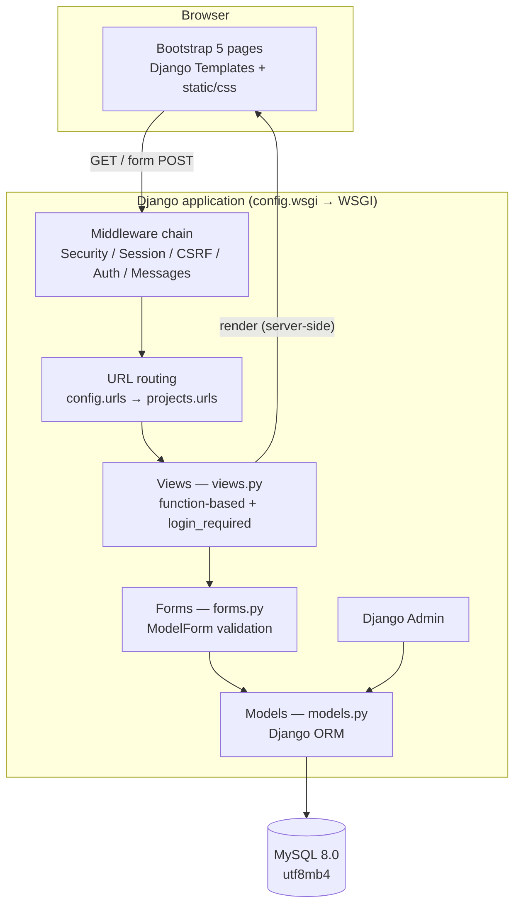
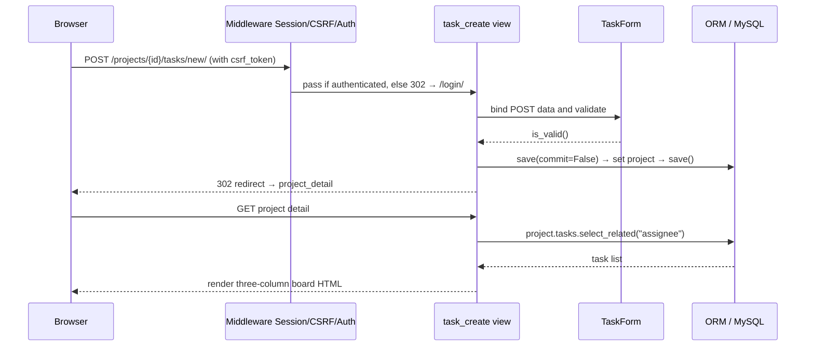
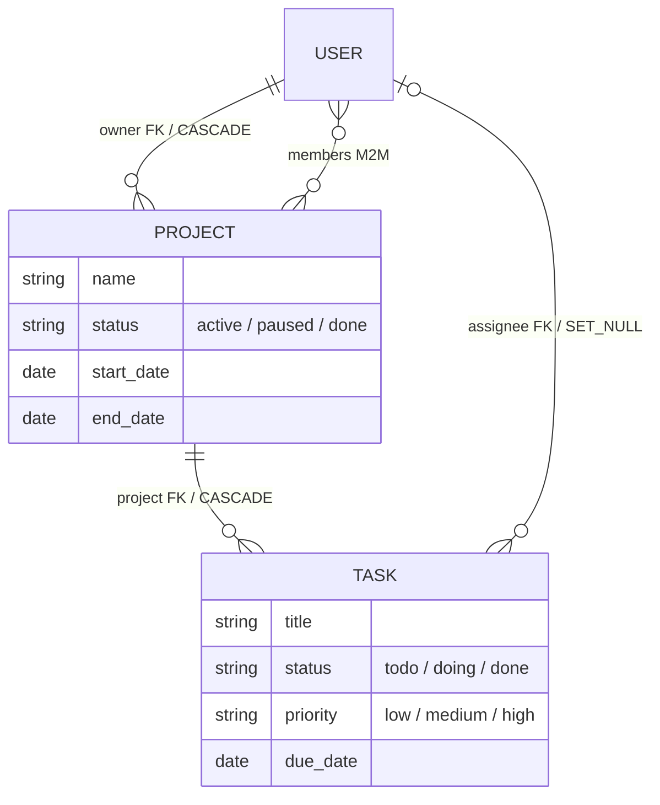
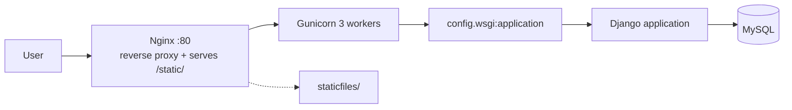

# PMS — Project Management System

[简体中文](README.md) (default) · [简体中文 zh-CN](README.zh-CN.md) · [繁體中文](README.zh-TW.md) · [English](README.en.md)

A lightweight project and task management system built with **Django 4.2 + MySQL**. It provides authentication, a dashboard with statistics, project management, member management, a three-column task board (To Do / In Progress / Done), and the Django Admin site. The UI is in Chinese, styled with Bootstrap 5, and uses the `Asia/Shanghai` time zone by default.

> For production deployment (Gunicorn + Nginx + systemd) and troubleshooting, see [部署指南](../../../docs/projects/python/pms-django/deployment.md) (in Simplified Chinese). For the architecture, see [Section 3](#3-architecture).

---

## 1. Features

- **Accounts**: Django's built-in authentication with login/logout; every business page requires login (`login_required`).
- **Dashboard**: total projects, total tasks, task counts per status, "My Projects" (latest 5) and "My Tasks" (up to 10 unfinished tasks).
- **Projects**: create, edit, delete, detail views; filter by status and name; owner and member management; a progress bar derived from completed tasks. **Only the owner can edit or delete a project.**
- **Tasks**: a three-column board on the project detail page; assign an executor, set priority (Low / Medium / High) and due date, and change status.
- **Admin site**: manage `Project` / `Task` in Django Admin with filters, search, and a horizontal member selector.

## 2. Tech Stack & Requirements

| Layer | Choice |
|-------|--------|
| Backend | Python 3.10+, Django 4.2.16 |
| Database | MySQL 8.0+ (5.7 also works), `utf8mb4` |
| Driver | PyMySQL 1.1.1 + `cryptography`; registered as `MySQLdb` in `config/__init__.py`, so no need to compile mysqlclient |
| Frontend | Django Templates + Bootstrap 5.3.3 (CDN) + custom `static/css/style.css` |
| Deployment | Gunicorn 22.0.0, optional Nginx reverse proxy |

Pinned dependencies in `requirements.txt`: `Django==4.2.16`, `PyMySQL==1.1.1`, `cryptography>=42.0.0`, `gunicorn==22.0.0`.

Custom styling lives in `static/css/style.css`: CSS variables define the palette, radii and card shadows; rules cover the navbar, dashboard stat cards, tables and progress bars, the three-column task board, forms and the login page, plus mobile layout and `prefers-reduced-motion` support. It loads after the Bootstrap CDN and only enhances visuals — grid and component structure are untouched.

## 3. Architecture

### 3.1 Layered Architecture



The system follows a **classic Django MTV monolithic architecture**: no separate frontend build, no REST API layer, no message queue or cache. Every page is rendered on the server; the browser only displays HTML and submits forms.

| Layer | Responsibility | Code |
|-------|----------------|------|
| Routing | URL dispatch; root URLconf mounts `projects.urls` and Admin | `config/urls.py`, `projects/urls.py` |
| Views | Access control, query assembly, form handling, redirects | `projects/views.py` |
| Forms | Field allow-lists, validation, widget styling | `projects/forms.py` |
| Models | Entities, status enums, derived statistics (progress) | `projects/models.py` |
| Templates | Page structure and Bootstrap presentation | `templates/`, `static/css/style.css` |
| Settings | Environment variables, database, auth redirects, static files | `config/settings.py` |
| Admin | Data maintenance and search | `projects/admin.py` |

### 3.2 Request Lifecycle (creating a task)



All writes follow the **POST → validate → persist → redirect (PRG)** pattern to avoid duplicate submissions on refresh. There is no AJAX; task status changes go through a dedicated edit form.

### 3.3 Data Model Relationships



- **Progress is computed at read time**: `Project.progress` derives from `tasks.filter(status="done").count() / task_count`. Nothing is persisted, so no synchronisation is needed.
- The board groups tasks by `status`; default ordering is `status, -priority, due_date`.
- Cascade rules: deleting a project deletes its tasks; deleting an owner deletes their projects (and their tasks); deleting an assignee keeps the task and sets `assignee` to `NULL`.

### 3.4 Authentication & Permission Boundaries

| Boundary | Implementation |
|----------|----------------|
| Anonymous access | `@login_required` redirects to `LOGIN_URL = "login"` |
| After login / logout | `LOGIN_REDIRECT_URL = "dashboard"`; logout returns to the login page |
| Project writes | `project.owner != request.user` silently redirects back to the detail page |
| Task writes | **No object-level permission check**, see [Section 10](#10-notes--known-limitations) |
| Admin site | Django Admin's `is_staff` and model-level permissions |

### 3.5 Configuration & Startup Chain

1. `manage.py` / `config.wsgi` set `DJANGO_SETTINGS_MODULE = config.settings`.
2. Importing the `config` package executes `config/__init__.py` first: PyMySQL is registered as `MySQLdb` and its version is spoofed to bypass Django's driver version check — hence no `mysqlclient` compilation.
3. `settings.py` reads `.env` with its built-in minimal loader (`os.environ.setdefault`, so system environment variables take precedence) and builds `DATABASES` (`utf8mb4` + `STRICT_TRANS_TABLES`).
4. `ROOT_URLCONF = config.urls` → `projects.urls`; templates load from `templates/`, static assets from `static/`, and `collectstatic` gathers them into `staticfiles/` for production.

### 3.6 Deployment Topology



### 3.7 Design Trade-offs & Extension Points

| Current choice | Impact | Possible evolution |
|----------------|--------|--------------------|
| Server-side rendering, no API layer | Simple to build; hard to serve mobile or third-party clients | Add Django REST Framework with serializers |
| Inline statistics queries in views | No cache needed; fine for small datasets | Use `annotate` / caching / pagination for large tables |
| Progress computed on read | Always consistent | Switch to a denormalised counter maintained by signals |
| No object-level permissions on tasks | Any logged-in user can modify any task | Add a permission layer or custom policy |
| Board without drag & drop | Status changes require the edit page | Add SortableJS + a status endpoint + CSRF handling |
| No automated tests | Regression checks are manual | Cover views, models and permissions in `tests.py` |

## 4. Quick Start

Prerequisites: MySQL installed and running, with an account allowed to create databases.

**1. Create the database** (run in a MySQL client)

```sql
CREATE DATABASE pms DEFAULT CHARACTER SET utf8mb4 COLLATE utf8mb4_unicode_ci;
```

For a dedicated database user, see section 3 of [部署指南](../../../docs/projects/python/pms-django/deployment.md).

**2. Create a virtual environment and install dependencies**

```bash
python3 -m venv .venv
source .venv/bin/activate        # Windows: .venv\Scripts\activate
pip install -r requirements.txt
```

**3. Configure environment variables**

```bash
cp .env.example .env
# Edit DB_*, SECRET_KEY and DEBUG as needed
```

> The `SECRET_KEY` in `.env.example` is a development placeholder — replace it in production. `.env` is excluded by `.gitignore`; never commit it.

**4. Initialise the database and create an admin user**

```bash
python manage.py migrate
python manage.py createsuperuser
```

The repository already contains `projects/migrations/0001_initial.py`. After changing models, run `python manage.py makemigrations projects` and then `migrate` again.

**5. Start the development server**

```bash
python manage.py runserver 0.0.0.0:8000
```

Open <http://127.0.0.1:8000/> to log in; the admin site is at <http://127.0.0.1:8000/admin/>.

## 5. Environment Variables

`config/settings.py` includes a minimal `.env` loader (one `KEY=VALUE` per line, `#` starts a comment). It uses `os.environ.setdefault`, so **system environment variables take precedence over the `.env` file**.

| Variable | Default | Description |
|----------|---------|-------------|
| `DEBUG` | `True` | `1` / `true` / `yes` enables debug mode (case-insensitive) |
| `SECRET_KEY` | `dev-insecure-secret-key-change-me` | Django signing key; must be replaced in production |
| `DB_NAME` | `pms` | Database name |
| `DB_USER` | `root` | Database user |
| `DB_PASSWORD` | empty | Database password |
| `DB_HOST` | `127.0.0.1` | Database host |
| `DB_PORT` | `3306` | Database port |

Other fixed settings: `LANGUAGE_CODE = "zh-hans"`, `TIME_ZONE = "Asia/Shanghai"`, `USE_TZ = True`, `STATIC_ROOT = staticfiles/`.

## 6. Project Structure

```
pms/
├── manage.py                     # Django management entry point
├── requirements.txt              # Python dependencies
├── .env.example                  # Environment variable template (copy to .env)
├── ../../../docs/projects/python/pms-django/deployment.md # Deployment & troubleshooting guide (Chinese)
├── ../../../docs/projects/python/pms-django/hot-deployment.md # Zero-downtime hot deploy guide (Chinese)
├── README.md / README.zh-CN.md / README.zh-TW.md / README.en.md
├── deploy/                       # Production & hot-deploy configuration
│   ├── gunicorn.conf.py          # Gunicorn graceful reload settings
│   ├── pms.service               # systemd unit (ExecReload)
│   ├── hot-deploy.sh             # Production hot deploy script
│   └── local-hot.sh              # Local CLI hot deploy / watch
├── config/
│   ├── __init__.py               # PyMySQL → MySQLdb compatibility shim
│   ├── settings.py               # Global settings (reads .env)
│   ├── urls.py                   # Root URLconf
│   └── wsgi.py                   # WSGI entry point
├── projects/                     # Core application
│   ├── models.py                 # Project / Task models
│   ├── views.py                  # Login, dashboard, project and task views
│   ├── forms.py / admin.py / urls.py / apps.py
│   ├── migrations/0001_initial.py
│   └── tests.py
├── templates/                    # base / dashboard / registration / projects templates
└── static/css/style.css
```

## 7. Pages & Routes

| Path | Description |
|------|-------------|
| `/` | Dashboard (statistics overview) |
| `/login/`, `/logout/` | Login, logout |
| `/projects/` | Project list, supports `?status=` and `?q=` filters |
| `/projects/new/` | Create project (creator becomes the owner) |
| `/projects/<pk>/` | Project detail and task board |
| `/projects/<pk>/edit/`, `/delete/` | Edit / delete project (owner only) |
| `/projects/<project_pk>/tasks/new/` | Create task |
| `/tasks/<pk>/edit/`, `/delete/` | Edit / delete task |
| `/admin/` | Django Admin site |

## 8. Data Models

**Project**: `name`, `description`, `status` (`active` / `paused` / `done`), `start_date`, `end_date`, `owner` (FK → User), `members` (M2M → User), `created_at`, `updated_at`. Ordered by creation time descending; derived properties `task_count`, `done_task_count`, and `progress` (percentage of completed tasks).

**Task**: `project` (FK → Project), `title`, `description`, `assignee` (FK → User, nullable), `status` (`todo` / `doing` / `done`), `priority` (`low` / `medium` / `high`), `due_date`, `created_at`, `updated_at`. Default ordering: `status`, `-priority`, `due_date`.

Deleting a project cascades to its tasks; deleting the assigned user sets the task's `assignee` to `NULL`.

## 9. Production Deployment

- Set `DEBUG=False` and replace `SECRET_KEY`. `ALLOWED_HOSTS` is currently hard-coded to `["*"]` in `settings.py`; restrict it to your real domains before going live.
- Collect static files: `python manage.py collectstatic --noinput` (output to `staticfiles/`).
- Start the app: `gunicorn config.wsgi:application --bind 127.0.0.1:8000 --workers 3`.
- Put Nginx in front as a reverse proxy and serve `/static/` directly.

Full systemd unit, Nginx config sample and troubleshooting table are in sections 5–6 of [部署指南](../../../docs/projects/python/pms-django/deployment.md).

**Hot deploy (zero-downtime release)**: `deploy/pms.service` uses `ExecReload=/bin/kill -HUP $MAINPID` to trigger a graceful Gunicorn reload. Run `./deploy/hot-deploy.sh` for routine releases (`--dry-run` to preview): it pulls code, installs dependencies, runs `migrate` and `collectstatic`, sends HUP, then polls `/login/` until it returns 200. Nginx needs no reload. This requires `preload_app = False` and backward-compatible migrations; see [热部署指南](../../../docs/projects/python/pms-django/hot-deployment.md) (in Chinese).

On a local dev machine, use `./deploy/local-hot.sh`: HUP reload by default, `watch` for auto-reload on `.py` / `.html` / `.css` changes, plus `start` / `status` / `stop`. No systemd, sudo or extra file-watching tools are needed; see section 10 of that guide.

## 10. Notes & Known Limitations

- Task **create / edit / delete currently only require login** — there is no per-project owner or assignee permission check. Project edit/delete is restricted to the owner.
- Bootstrap 5 CSS/JS are loaded from the jsDelivr CDN; for offline or intranet deployment, host them locally.
- The project list is not paginated; the dashboard shows only the first 5 projects and 10 pending tasks.
- `projects/tests.py` contains only imports — no test cases have been written yet.
- No open-source license is declared; add a `LICENSE` before publishing.

## 11. Checks & Tests

```bash
python manage.py check
python manage.py test
```

## 12. Related Documentation

| Document | Contents |
|----------|----------|
| [部署指南](../../../docs/projects/python/pms-django/deployment.md) | Prerequisites, database SQL, production deployment, FAQ, roadmap (in Simplified Chinese) |
| [热部署指南](../../../docs/projects/python/pms-django/hot-deployment.md) | Gunicorn HUP graceful reload, one-command release script, rollback and FAQ (in Simplified Chinese) |
| [README.md](README.md) | 简体中文 (Simplified Chinese, default) |
| [README.zh-CN.md](README.zh-CN.md) | 简体中文 (language-code named copy) |
| [README.zh-TW.md](README.zh-TW.md) | 繁體中文 (Traditional Chinese) |
| [README.en.md](README.en.md) | English version |

## 13. License

No open-source license has been declared yet.
