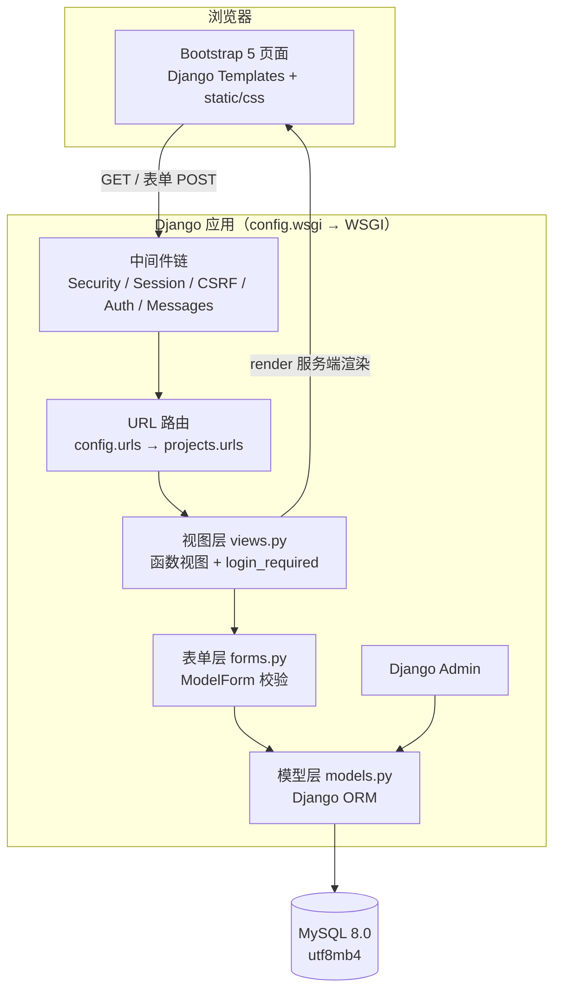
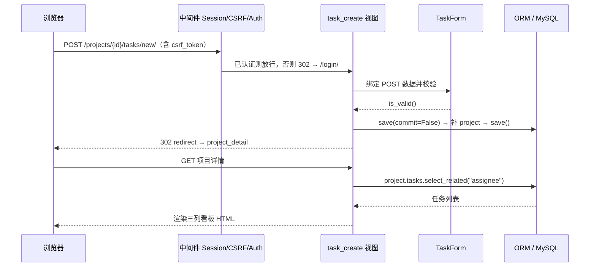
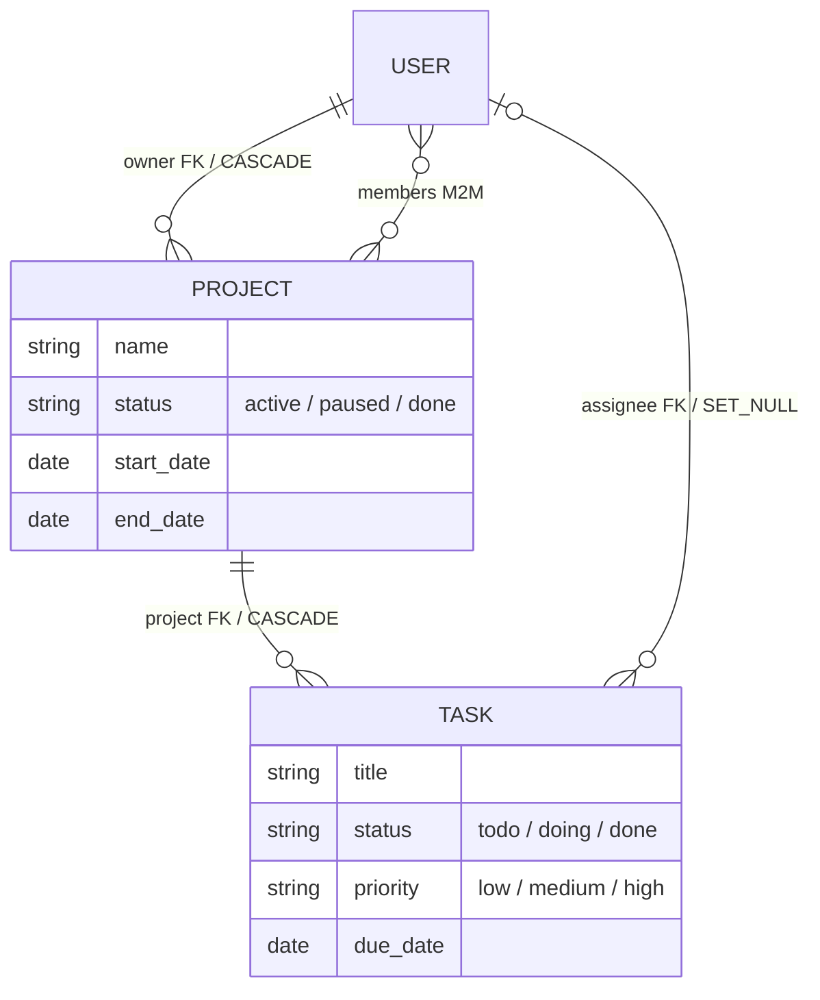
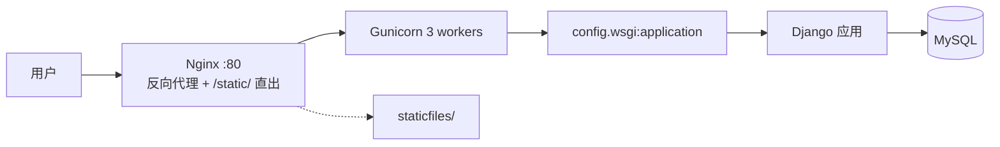

# PMS 项目管理系统

[简体中文](README.md)（默认入口） · [简体中文 zh-CN](README.zh-CN.md) · [繁體中文](README.zh-TW.md) · [English](README.en.md)

基于 **Django 4.2 + MySQL** 的轻量级项目与任务管理系统。提供账号认证、工作台统计概览、项目管理、成员管理、任务看板（待处理 / 进行中 / 已完成）以及 Django Admin 后台。界面为中文，使用 Bootstrap 5，默认时区 `Asia/Shanghai`。

> 生产环境部署（Gunicorn + Nginx + systemd）与常见问题排查，见[部署指南](../../../docs/projects/python/pms-django/deployment.md)。架构设计见 [第 3 节](#3-架构设计)。
>
> 本地环境准备、数据库配置和启动步骤见[搭建指南](../../../docs/projects/python/pms-django/setup.md)。

---

## 1. 功能特性

- **账号**：Django 内置认证，登录 / 退出；所有业务页面均需登录（`login_required`）。
- **工作台**：项目总数、任务总数、各状态任务数；「我的项目」（前 5 条）与「我的待办」（前 10 条未完成任务）。
- **项目管理**：新建、编辑、删除、详情；按状态与名称筛选；负责人与成员管理；按已完成任务比例计算的进度条。**编辑与删除仅负责人可操作**。
- **任务管理**：项目详情内的三列看板，可指派执行人、设置优先级（低 / 中 / 高）与截止日期，并切换状态。
- **后台管理**：Django Admin 中管理 `Project` / `Task`，支持筛选、搜索与成员横向选择。

## 2. 技术栈与环境要求

| 层次 | 选型 |
|------|------|
| 后端 | Python 3.10+、Django 4.2.16 |
| 数据库 | MySQL 8.0+（5.7 亦可），`utf8mb4` |
| 驱动 | PyMySQL 1.1.1 + `cryptography`；在 `config/__init__.py` 中伪装为 `MySQLdb`，无需编译 mysqlclient |
| 前端 | Django Templates + Bootstrap 5.3.3（CDN）+ 自定义 `static/css/style.css` |
| 部署 | Gunicorn 22.0.0，Nginx 反向代理（生产可选） |

依赖固定版本见 `requirements.txt`：`Django==4.2.16`、`PyMySQL==1.1.1`、`cryptography>=42.0.0`、`gunicorn==22.0.0`。

自定义样式位于 `static/css/style.css`：用 CSS 变量统一配色、圆角与卡片阴影，覆盖导航栏、工作台统计卡、表格与进度条、任务看板三列、表单及登录页，并包含移动端适配与「减少动态效果」偏好支持。它在 Bootstrap CDN 之后加载，仅做视觉增强，不改动栅格与组件结构。

## 3. 架构设计

### 3.1 分层架构



系统采用**经典 Django MTV 单体架构**：没有独立前端工程、没有 REST API 层，也没有消息队列与缓存；页面全部由服务端渲染，浏览器只负责展示与提交表单。

| 层 | 职责 | 代码位置 |
|----|------|---------|
| 路由 | URL 分发；根路由挂载 `projects.urls` 与 Admin | `config/urls.py`、`projects/urls.py` |
| 视图 | 权限门禁、查询组装、表单处理、重定向 | `projects/views.py` |
| 表单 | 字段白名单、校验与控件样式 | `projects/forms.py` |
| 模型 | 业务实体、状态枚举、派生统计（进度） | `projects/models.py` |
| 模板 | 页面结构与 Bootstrap 展示 | `templates/`、`static/css/style.css` |
| 配置 | 环境变量、数据库、认证跳转、静态文件 | `config/settings.py` |
| 后台 | 数据维护与检索 | `projects/admin.py` |

### 3.2 请求生命周期（以新建任务为例）



所有写操作遵循 **POST → 校验 → 落库 → 重定向（PRG）** 模式，避免刷新导致重复提交；页面不使用 AJAX，任务状态通过独立编辑表单变更。

### 3.3 数据模型关系



- **进度是读时计算**：`Project.progress` 由 `tasks.filter(status="done").count() / task_count` 实时得出，不落库，无需额外同步。
- 看板按 `status` 分组渲染；任务默认排序为 `status, -priority, due_date`。
- 级联策略：删除项目 → 级联删除其任务；删除负责人 → 级联删除其名下项目（及其任务）；删除执行人 → 任务保留，`assignee` 置空。

### 3.4 认证与权限边界

| 边界 | 实现方式 |
|------|---------|
| 未登录访问 | `@login_required` 统一跳转 `LOGIN_URL = "login"` |
| 登录 / 退出后 | `LOGIN_REDIRECT_URL = "dashboard"`；退出回到登录页 |
| 项目写操作 | `project.owner != request.user` 时静默重定向回详情页 |
| 任务写操作 | **暂无对象级权限校验**，见 [第 10 节](#10-注意事项与已知限制) |
| 后台 | Django Admin 自带 `is_staff` 与模型级权限 |

### 3.5 配置与启动链路

1. `manage.py` / `config.wsgi` 设定 `DJANGO_SETTINGS_MODULE = config.settings`。
2. 导入 `config` 包时先执行 `config/__init__.py`：将 PyMySQL 注册为 `MySQLdb`，并伪装版本号绕过 Django 的驱动版本检查，因此无需编译 `mysqlclient`。
3. `settings.py` 用内置极简加载器读取 `.env`（`os.environ.setdefault`，系统环境变量优先），据此组装 `DATABASES`（`utf8mb4` + `STRICT_TRANS_TABLES`）。
4. `ROOT_URLCONF = config.urls` → `projects.urls`；模板从 `templates/` 加载，静态资源来自 `static/`，生产环境由 `collectstatic` 汇总至 `staticfiles/`。

### 3.6 部署拓扑



### 3.7 设计取舍与扩展点

| 当前取舍 | 影响 | 可选演进 |
|---------|------|---------|
| 服务端渲染、无 API 层 | 实现简单，但难以支撑移动端与第三方集成 | 引入 Django REST Framework，拆出序列化器 |
| 视图内联统计查询 | 无需缓存，小数据量足够 | 大表场景改用 `annotate` / 缓存 / 分页 |
| 进度实时计算 | 数据始终一致 | 任务量大时改为冗余计数字段 + 信号维护 |
| 任务无对象级权限 | 任何登录用户可改任意任务 | 增加权限校验层或自定义策略 |
| 看板无拖拽 | 状态变更需进入编辑页 | 引入 SortableJS + 状态更新接口 + CSRF |
| 无自动化测试 | 回归依赖人工 | 为视图、模型、权限补齐 `tests.py` 用例 |

## 4. 快速开始

前置条件：已安装并启动 MySQL，且拥有可建库的账号。

**① 创建数据库**（在 MySQL 客户端执行）

```sql
CREATE DATABASE pms DEFAULT CHARACTER SET utf8mb4 COLLATE utf8mb4_unicode_ci;
```

如需专用账号，可参考 [部署指南](../../../docs/projects/python/pms-django/deployment.md) 第三节的建用户与授权 SQL。

**② 创建虚拟环境并安装依赖**

```bash
python3 -m venv .venv
source .venv/bin/activate        # Windows: .venv\Scripts\activate
pip install -r requirements.txt
```

**③ 配置环境变量**

```bash
cp .env.example .env
# 按需修改 DB_*、SECRET_KEY、DEBUG
```

> `.env.example` 中的 `SECRET_KEY` 仅为开发占位值，生产环境必须替换；`.env` 已被 `.gitignore` 排除，请勿提交。

**④ 初始化数据库并创建管理员**

```bash
python manage.py migrate
python manage.py createsuperuser
```

仓库已包含 `projects/migrations/0001_initial.py`。若修改了模型，再执行 `python manage.py makemigrations projects` 后重新 `migrate`。

**⑤ 启动开发服务器**

```bash
python manage.py runserver 0.0.0.0:8000
```

浏览器打开 <http://127.0.0.1:8000/> 登录使用；后台地址为 <http://127.0.0.1:8000/admin/>。

## 5. 环境变量

`config/settings.py` 内置极简 `.env` 加载器（每行 `KEY=VALUE`，`#` 开头为注释），使用 `os.environ.setdefault`，因此**系统环境变量优先于 `.env` 文件**。

| 变量 | 默认值 | 说明 |
|------|--------|------|
| `DEBUG` | `True` | 值为 `1` / `true` / `yes` 时视为开启（不区分大小写） |
| `SECRET_KEY` | `dev-insecure-secret-key-change-me` | Django 签名密钥，生产必须更换 |
| `DB_NAME` | `pms` | 数据库名 |
| `DB_USER` | `root` | 数据库账号 |
| `DB_PASSWORD` | 空 | 数据库密码 |
| `DB_HOST` | `127.0.0.1` | 数据库地址 |
| `DB_PORT` | `3306` | 数据库端口 |

其他固定配置：`LANGUAGE_CODE = "zh-hans"`、`TIME_ZONE = "Asia/Shanghai"`、`USE_TZ = True`、`STATIC_ROOT = staticfiles/`。

## 6. 目录结构

```
pms/
├── manage.py                     # Django 管理入口
├── requirements.txt              # Python 依赖
├── .env.example                  # 环境变量示例（复制为 .env 使用）
├── ../../../docs/projects/python/pms-django/deployment.md # 中文部署与排错指南
├── ../../../docs/projects/python/pms-django/hot-deployment.md # 不停机发布指南
├── README.md / README.zh-CN.md / README.zh-TW.md / README.en.md
├── deploy/                       # 生产与热部署配置
│   ├── gunicorn.conf.py          # Gunicorn 优雅重载参数
│   ├── pms.service               # systemd 单元（ExecReload）
│   ├── hot-deploy.sh             # 生产一键热部署脚本
│   └── local-hot.sh              # 本地命令行热部署 / watch
├── config/
│   ├── __init__.py               # PyMySQL → MySQLdb 兼容层
│   ├── settings.py               # 全局配置（读取 .env）
│   ├── urls.py                   # 根路由
│   └── wsgi.py                   # WSGI 入口
├── projects/                     # 核心应用
│   ├── models.py                 # Project / Task 模型
│   ├── views.py                  # 登录、工作台、项目、任务视图
│   ├── forms.py / admin.py / urls.py / apps.py
│   ├── migrations/0001_initial.py
│   └── tests.py
├── templates/                    # base / dashboard / registration / projects 页面模板
└── static/css/style.css
```

## 7. 页面与路由

| 路径 | 说明 |
|------|------|
| `/` | 工作台（统计概览） |
| `/login/`、`/logout/` | 登录、退出 |
| `/projects/` | 项目列表，支持 `?status=` 与 `?q=` 筛选 |
| `/projects/new/` | 新建项目（创建者自动成为负责人） |
| `/projects/<pk>/` | 项目详情与任务看板 |
| `/projects/<pk>/edit/`、`/delete/` | 编辑、删除项目（仅负责人） |
| `/projects/<project_pk>/tasks/new/` | 新建任务 |
| `/tasks/<pk>/edit/`、`/delete/` | 编辑、删除任务 |
| `/admin/` | Django Admin 后台 |

## 8. 数据模型

**Project（项目）**：`name`、`description`、`status`（`active` 进行中 / `paused` 已暂停 / `done` 已完成）、`start_date`、`end_date`、`owner`（外键 → User）、`members`（多对多 → User）、`created_at`、`updated_at`。按创建时间倒序排列；派生属性 `task_count`、`done_task_count`、`progress`（完成任务百分比）。

**Task（任务）**：`project`（外键 → Project）、`title`、`description`、`assignee`（外键 → User，可空）、`status`（`todo` / `doing` / `done`）、`priority`（`low` / `medium` / `high`）、`due_date`、`created_at`、`updated_at`。默认按 `status`、`-priority`、`due_date` 排序。

删除项目会级联删除其下所有任务；删除执行人用户时任务的 `assignee` 置空。

## 9. 生产部署要点

- 设置 `DEBUG=False`，更换 `SECRET_KEY`；`ALLOWED_HOSTS` 当前在 `settings.py` 中硬编码为 `["*"]`，上线前请改为实际域名。
- 收集静态文件：`python manage.py collectstatic --noinput`（输出到 `staticfiles/`）。
- 启动应用：`gunicorn config.wsgi:application --bind 127.0.0.1:8000 --workers 3`。
- 由 Nginx 反向代理应用，并直接托管 `/static/`。

完整的 systemd 服务配置、Nginx 配置示例及排错表格见 [部署指南](../../../docs/projects/python/pms-django/deployment.md) 第五、六节。

**热部署（不停机发布）**：`deploy/pms.service` 通过 `ExecReload=/bin/kill -HUP $MAINPID` 触发 Gunicorn 优雅重载；日常发布执行 `./deploy/hot-deploy.sh`（可先加 `--dry-run` 演练），脚本依次完成代码拉取、依赖安装、`migrate`、`collectstatic`、HUP 重载与 `/login/` 健康检查，全程不中断，Nginx 无需 reload。前提是 `preload_app = False` 且数据库迁移向后兼容；详见 [热部署指南](../../../docs/projects/python/pms-django/hot-deployment.md)。

本地开发机可直接使用 `./deploy/local-hot.sh`：默认执行 HUP 热重载，`watch` 子命令监听 `.py` / `.html` / `.css` 变化自动重载，另有 `start` / `status` / `stop`；无需 systemd、sudo 或额外监听工具，详见该文档第十节。

## 10. 注意事项与已知限制

- 任务的**新建 / 编辑 / 删除目前仅要求登录**，未按项目负责人或执行人做权限校验；项目的编辑与删除则已限制为负责人。
- Bootstrap 5 的 CSS / JS 来自 jsDelivr CDN，离线或内网部署时需改为本地静态资源。
- 项目列表暂未分页；工作台「我的项目」「我的待办」分别只展示前 5 / 前 10 条。
- `projects/tests.py` 目前仅有导入语句，尚未编写测试用例。
- 仓库未声明开源许可，如需对外发布请先补充 `LICENSE`。

## 11. 检查与测试

```bash
python manage.py check
python manage.py test
```

## 12. 相关文档

| 文档 | 内容 |
|------|------|
| [搭建指南](../../../docs/projects/python/pms-django/setup.md) | 本地 Python 环境、MySQL 配置、迁移、管理员创建与开发服务器启动步骤 |
| [部署指南](../../../docs/projects/python/pms-django/deployment.md) | 环境准备、建库 SQL、生产部署、常见问题、后续扩展建议（中文） |
| [热部署指南](../../../docs/projects/python/pms-django/hot-deployment.md) | Gunicorn HUP 优雅重载、一键发布脚本、回滚与排错（中文） |
| [README.md](README.md) | 简体中文（默认入口） |
| [README.zh-CN.md](README.zh-CN.md) | 简体中文（按语言代码命名的副本） |
| [README.zh-TW.md](README.zh-TW.md) | 繁體中文版 |
| [README.en.md](README.en.md) | English version |

## 13. 许可

暂未声明开源许可。
